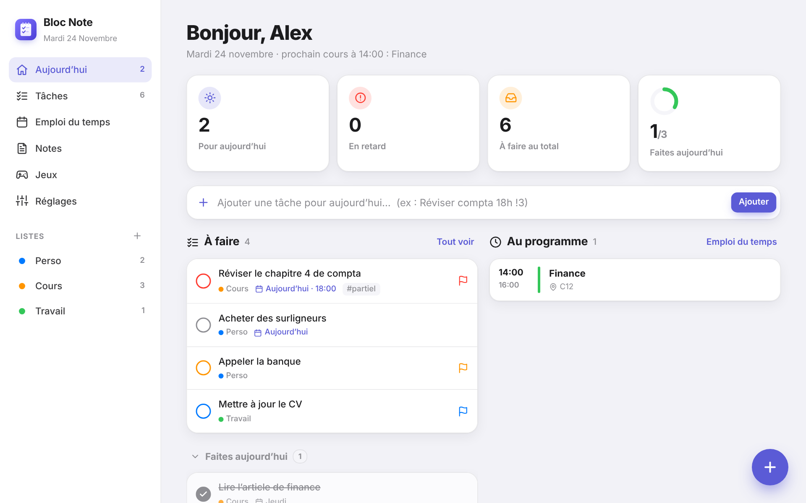
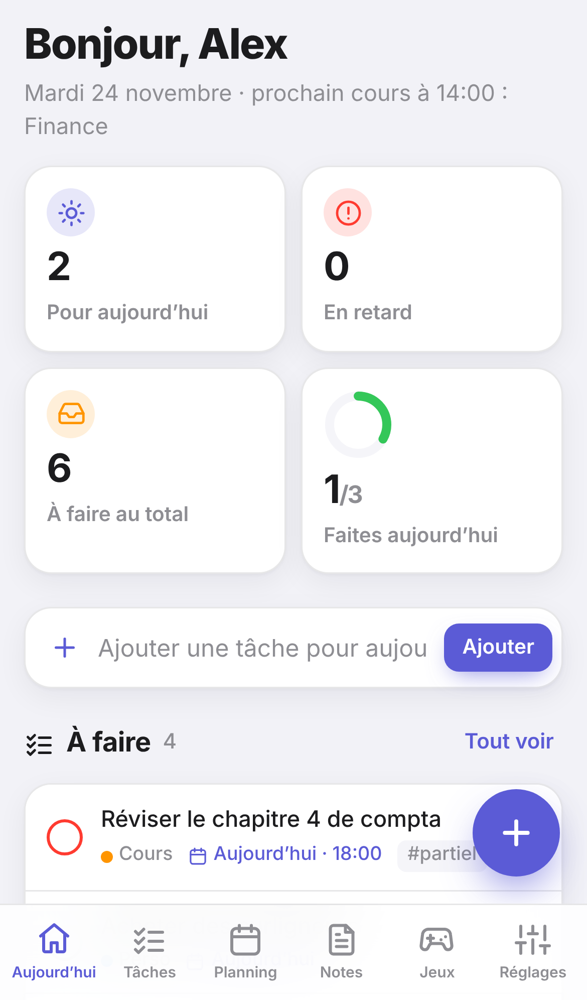
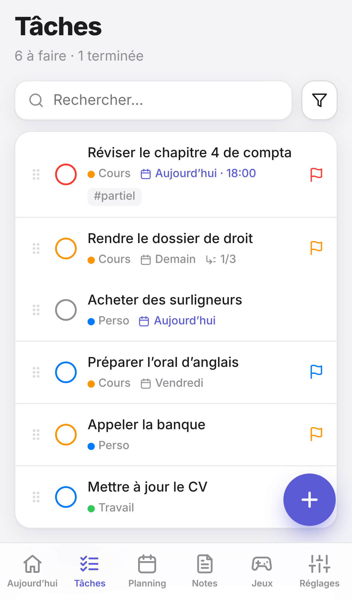
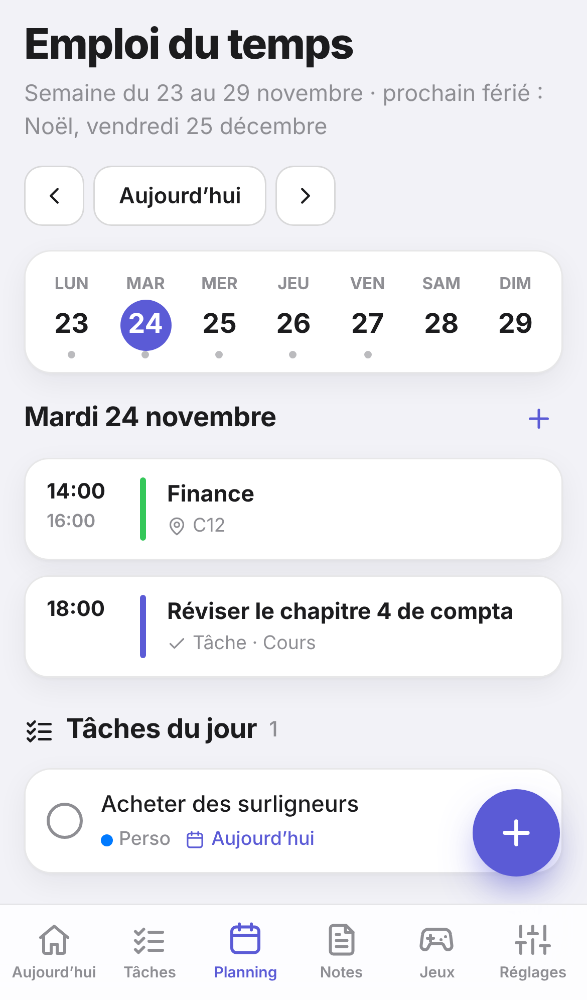
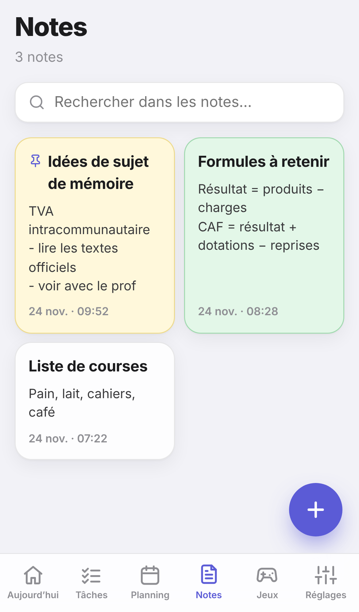
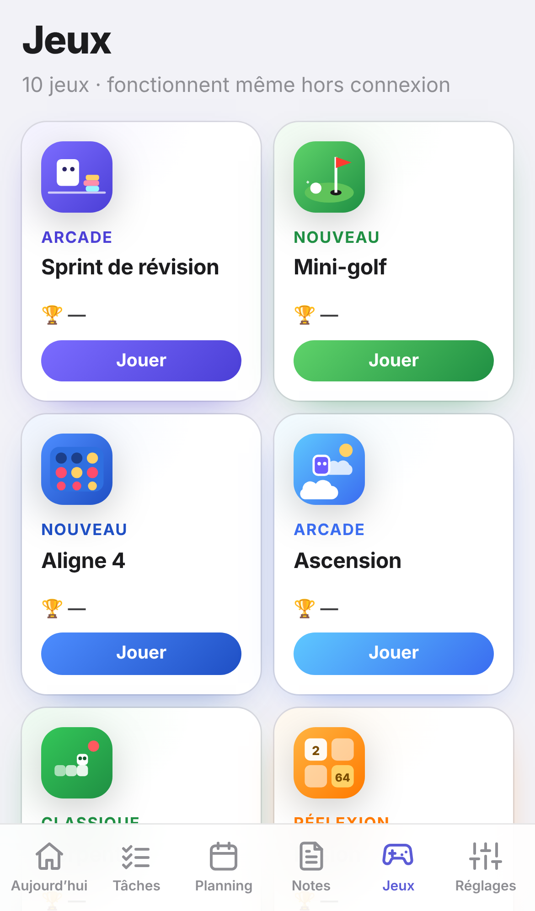
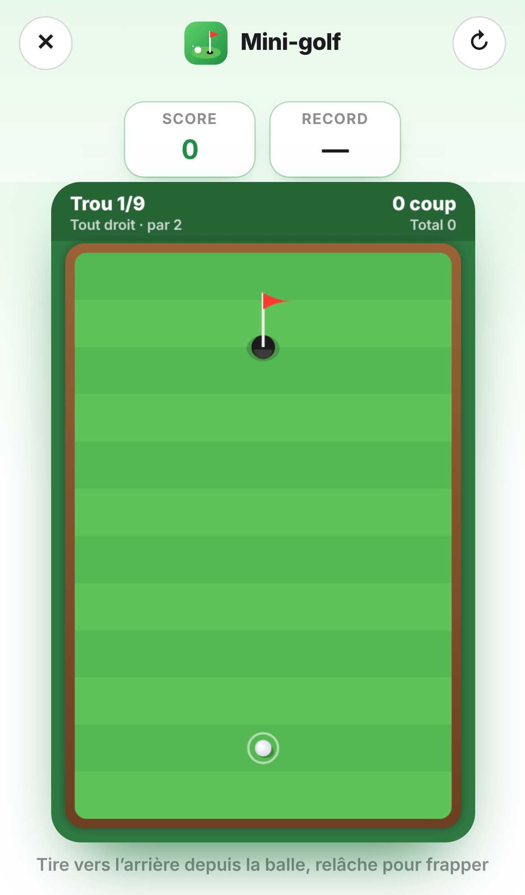
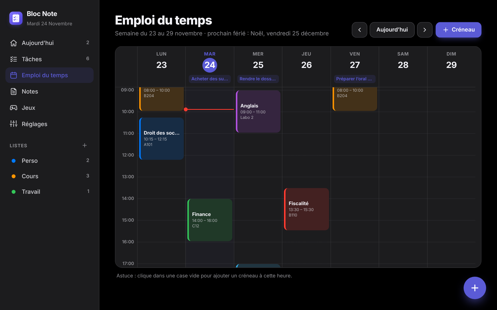

<div align="center">


# Bloc Note

**Tes tâches, ton emploi du temps et tes notes, au même endroit, sur tous tes appareils.**

Une application web légère et soignée, pensée pour le téléphone comme pour l'ordinateur.
Elle s'installe sur l'écran d'accueil comme une vraie app et fonctionne même sans connexion.

[](https://tauwni.github.io/Bloc-note/)


<br>



</div>

<br>

## Sommaire

- [Fonctionnalités](#fonctionnalités)
- [Aperçu](#aperçu)
- [Astuces](#astuces)
- [Compte et synchronisation](#compte-et-synchronisation)
- [Installer l’app sur son téléphone](#installer-lapp-sur-son-téléphone)
- [Mettre en ligne sa propre version](#mettre-en-ligne-sa-propre-version)
- [Organisation du code](#organisation-du-code)
- [Vie privée](#vie-privée)

<br>

## Fonctionnalités

### ☀️ Aujourd’hui

- Message d’accueil, date du jour et prochain cours de la journée
- Quatre compteurs : tâches du jour, en retard, à faire au total, et progression du jour avec un anneau
- **Ajout rapide** en une ligne, qui comprend la date, l’heure, la priorité et la liste
- Les cours du jour, avec le cours en cours mis en avant
- Les tâches faites dans la journée restent visibles dans une section repliable

### ✅ Tâches

- Priorités (aucune, basse, moyenne, haute) avec code couleur
- Date et heure d’échéance, avec « Aujourd’hui », « Demain » ou « En retard » affiché clairement
- Listes personnalisables (Perso, Cours, Travail…) avec couleur
- Étiquettes, notes et **sous-tâches**
- **Glisser-déposer** pour ranger les tâches dans ton ordre, au doigt comme à la souris
- Recherche instantanée, et un panneau **Filtres** (échéance, liste, priorité, statut, tri)
- Les tâches terminées passent dans une section « Terminées » qu’on peut replier
- Toute suppression peut être annulée pendant quelques secondes

### 📅 Emploi du temps

- Grille de la semaine sur ordinateur, liste par jour sur téléphone
- Cours **chaque semaine** ou **une seule fois**, sur **plusieurs jours d’un coup** (raccourci « Lun → Ven »)
- Salle, couleur et remarque pour chaque créneau
- **Jours fériés français** calculés automatiquement (Pâques, Ascension, Pentecôte comprises), et cours masqués ces jours-là si tu le souhaites
- Ligne rouge à l’heure actuelle, et tâches datées affichées dans le planning
- Clic dans une case vide : un créneau est créé à cette heure-là

### 📝 Notes

- Notes colorées et épinglables, enregistrées automatiquement pendant que tu écris
- Recherche dans le titre et le contenu

### 🎮 Jeux

Dix mini-jeux originaux pour faire une pause, jouables hors connexion, avec un record pour chacun :

| | | |
|---|---|---|
| ⛳ **Mini-golf** : 9 trous avec moulin, bunkers et eau | 🔴 **Aligne 4** contre l’ordinateur | ☁️ **Ascension** : de nuage en nuage |
| 🏃 **Sprint de révision** : course sans fin | 🐍 **Serpent** | 🔢 **Fusion** : tuiles à additionner |
| 💣 **Démineur** | 🧱 **Casse-briques** | 🃏 **Mémoire** |
| ❌ **Morpion** contre l’ordinateur | | |

### ⚙️ Et aussi

- Thème **clair, sombre ou automatique**, et 10 couleurs principales au choix
- Animations soignées (désactivées automatiquement si ton appareil le demande)
- **Fonctionne hors connexion** une fois l’app ouverte une première fois
- Export et import d’une sauvegarde complète

<br>

## Aperçu

<div align="center">

| Aujourd’hui | Tâches | Emploi du temps |
|:---:|:---:|:---:|
|  |  |  |

| Notes | Jeux | Mini-golf |
|:---:|:---:|:---:|
|  |  |  |

<br>



<sub>Emploi du temps sur ordinateur, en thème sombre. Toutes les captures utilisent des données d’exemple.</sub>

</div>

<br>

## Astuces

### Ajout rapide en une ligne

Dans le champ « Ajouter une tâche » de l’écran Aujourd’hui, tu peux tout écrire d’un coup :

```text
Réviser compta demain 18h !3 #cours
```

| Écris | Pour |
|---|---|
| `aujourd'hui`, `demain`, `après-demain` | la date |
| `lundi` … `dimanche` | le prochain jour de ce nom |
| `18h`, `9h30`, `à 14h` | l’heure |
| `!1`, `!2`, `!3` ou `!haute` | la priorité (basse, moyenne, haute) |
| `#cours`, `#perso`… | la liste (son nom exact) |

### Raccourcis

| Geste | Effet |
|---|---|
| Glisser la poignée `⋮⋮` d’une tâche | changer l’ordre (en mode « Mon ordre ») |
| Bouton `+` en bas à droite | ajouter dans l’écran en cours (tâche, créneau ou note) |
| Clic dans une case vide du planning | créer un créneau à cette heure |
| `Échap` | fermer une fenêtre ou un jeu |

<br>

## Compte et synchronisation

Sur la version Netlify, on se connecte avec un **prénom** et un **code perso à 6 chiffres**.

- Écran **Connexion** / **Créer un compte**, avec un lien « Pas encore de compte ? »
- Les tâches, l’emploi du temps et les notes sont **synchronisés** entre tous tes appareils
- Sans réseau, l’app continue de marcher : l’envoi se fait au retour de la connexion
- Le code est **chiffré** sur le serveur, et le compte est bloqué 15 minutes après 5 erreurs
- On reste connecté 90 jours, et « Se déconnecter » se trouve dans les Réglages

> [!NOTE]
> La version GitHub Pages (`tauwni.github.io/Bloc-note`) n’a pas de serveur : elle marche **sans compte**, avec les données sur l’appareil seulement. Pour passer de l’une à l’autre, utilise **Réglages → Sauvegarde → Exporter**, puis **Importer** sur l’autre version.

<br>

## Installer l’app sur son téléphone

| iPhone (Safari) | Android (Chrome) |
|---|---|
| 1. Ouvre le site | 1. Ouvre le site |
| 2. Touche **Partager** | 2. Touche le menu **⋮** |
| 3. Choisis **Sur l’écran d’accueil** | 3. Choisis **Installer l’application** |

L’app s’ouvre alors en plein écran, avec son icône, comme une application normale.

<br>

## Mettre en ligne sa propre version

### Option 1 : GitHub Pages (sans compte)

1. Fais une copie de ce dépôt (**Fork**)
2. **Settings → Pages → Deploy from a branch → `main` / root**
3. L’app est en ligne sur `https://<ton-pseudo>.github.io/Bloc-note/`

### Option 2 : Netlify (avec comptes et synchronisation)

1. Sur [Netlify](https://app.netlify.com) : **Add new site → Import an existing project → GitHub**, puis choisis ce dépôt
2. Laisse les réglages proposés : tout est déjà dans `netlify.toml`
3. Clique sur **Deploy**

Il n’y a ni base de données à créer ni clé à configurer : les comptes sont stockés avec **Netlify Blobs**.

> [!TIP]
> Chaque mise en ligne consomme des crédits Netlify. Pour une modification qui ne touche que la documentation, ajoute `[skip netlify]` dans le message de commit : Netlify ne refera pas de mise en ligne.

<br>

## Organisation du code

Aucun framework et aucune étape de compilation : de simples fichiers HTML, CSS et JavaScript.

```text
Bloc-note/
├── index.html               Structure de la page
├── style.css                Tout le design (thèmes clair et sombre, animations)
├── app.js                   Tâches, emploi du temps, notes, réglages
├── games.js                 Les 10 mini-jeux
├── sync.js                  Écran de connexion et synchronisation
├── sw.js                    Fonctionnement hors connexion
├── manifest.webmanifest     Installation sur l’écran d’accueil
├── icon.svg / icon-*.png    Logo et icônes
├── netlify.toml             Réglages Netlify
├── package.json             Dépendance du serveur (@netlify/blobs)
├── netlify/functions/
│   └── api.mjs              Serveur des comptes : inscription, connexion, données
└── docs/                    Captures d’écran de ce README
```

| Côté | Technologies |
|---|---|
| Interface | HTML, CSS (variables, `color-mix`, animations), JavaScript sans dépendance |
| Jeux | Canvas 2D et DOM, 60 images par seconde |
| Hors ligne | Service worker (le réseau d’abord, la copie locale en secours) |
| Serveur | Netlify Functions et Netlify Blobs |
| Sécurité | Code haché avec PBKDF2, session par cookie `HttpOnly` et `Secure` |

<br>

## Vie privée

- Aucune publicité, aucun traceur, aucune statistique de visite
- Sans compte, tout reste dans le navigateur de ton appareil
- Avec un compte, tes données sont stockées sur le site Netlify du propriétaire de l’app, et seulement là
- Le code perso n’est jamais enregistré en clair

<br>

<div align="center">

Fait avec soin pour s’organiser sans prise de tête.

<sub>Projet personnel</sub>

</div>
